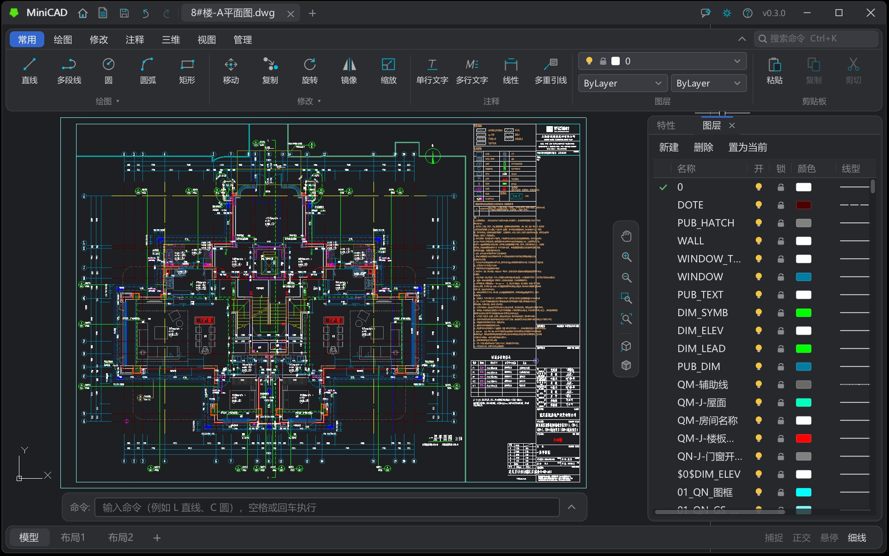

<p align="center">
  
</p>

<h1 align="center">MiniCAD</h1>

<p align="center">
  <strong>开源 2D/3D CAD 应用，使用C++20开发。</strong><br />
  在windows和浏览器内运行CAD，内核使用SMLib, 支持三维Node节点建模，<strong>兼容dwg、天正</strong>。
</p>

<p align="center">
  <a href="https://minicad.bimhub.top">网页版</a> ·
  <a href="https://github.com/CHMOSE023/MiniCAD/releases">下载桌面版</a>     
</p>
 
<p align="center">
  <a href="https://github.com/CHMOSE023/MiniCAD/actions/workflows/build.yml">
  
  </a>
  <a href="https://github.com/CHMOSE023/MiniCAD/releases/latest"></a>
  <a href="https://github.com/CHMOSE023/MiniCAD/releases"></a>
  <a href="LICENSE"></a>
  <a href="https://qm.qq.com/q/O08yWfRvmE"></a>
  <a href="https://github.com/CHMOSE023/MiniCAD/stargazers"></a>
</p>


 

## Windows版编译

需要 CMake 3.20+、Ninja、Visual Studio（MSVC，C++20）。

```bat
cmake --preset debug
cmake --build --preset debug
out\debug\MiniCADWin\MiniCADWin.exe
```
**选择以下任意环境编译** 

-  "Developer Command Prompt for VS"中执行上述命令

-  **PowerShell** VS开发环境： cmd /k """C:\Program Files\Microsoft Visual Studio\18\Community\Common7\Tools\VsDevCmd.bat"" -arch=x64 -host_arch=x64"

-  **PowerShell** x64编译环境： cmd /k """C:\Program Files\Microsoft Visual Studio\18\Community\VC\Auxiliary\Build\vcvars64.bat"""


**发布版用 `release`编译** 

## Web版编译

需要 [Emscripten SDK](https://emscripten.org)（路径 `D:\dev\emsdk`）, Web版编译脚本 `build_wasm.bat` 。

```bat
build_wasm.bat serve
```

输出目录 `out/build/wasm/MiniCADWeb/`，serve 参数，自动启动本地服务器， http://localhost:8080/MiniCADWeb。

网页版默认用浏览器的 WebGPU，不支持时自动改用 WebGL2；网址加 `?webgl` 强制用 WebGL2。第一次构建时 Emscripten 会从 GitHub 下载 WebGPU 绑定（emdawnwebgpu 端口包），需要联网。

## Linux版编译

需要 CMake 3.20+、Ninja、GCC 13+ 或 Clang（C++20）、OpenGL ES 3 / EGL 开发包、[SDL3](https://github.com/libsdl-org/SDL)。以 Ubuntu / Debian 为例：

```bash
sudo apt install build-essential cmake ninja-build pkg-config libegl-dev libgles-dev \
    libx11-dev libxext-dev libxrandr-dev libxcursor-dev libxi-dev libxfixes-dev libxss-dev libxtst-dev \
    libxkbcommon-dev libwayland-dev wayland-protocols libdbus-1-dev libudev-dev
```

SDL3：Ubuntu 25.04 / Debian 13 起可以 `sudo apt install libsdl3-dev`；更早的发行版从源码编译安装（例如装到 `~/sdl3`）：

```bash
cmake -S SDL3-3.4.18 -B sdl3-build -G Ninja -DCMAKE_BUILD_TYPE=Release -DCMAKE_INSTALL_PREFIX=$HOME/sdl3 -DSDL_TESTS=OFF
cmake --build sdl3-build && cmake --install sdl3-build
```

编译 MiniCAD（SDL3 装在系统目录时去掉 `CMAKE_PREFIX_PATH`）：

```bash
cmake -S . -B out/linux -G Ninja -DCMAKE_BUILD_TYPE=Release -DCMAKE_PREFIX_PATH=$HOME/sdl3
cmake --build out/linux
out/linux/MiniCADLinux/MiniCADLinux [图纸路径 ...]
```

找不到 SDL3 或 OpenGL ES 3 时只编译核心库与测试（`ctest --test-dir out/linux`）。打开、保存文件的对话框需要 xdg-desktop-portal 或 zenity，没有时可以把图纸拖进窗口或在命令行上给出。

## 测试

```bat
run_tests.bat
```
    
## 第三方组件

- SMLib实体建模 [usd-brep](https://github.com/NVIDIA-Omniverse/usd-brep)
- DWG解析移植自 [ACadSharp](https://github.com/DomCR/ACadSharp)
- 图像加载使用 [stb_image](https://github.com/nothings/stb/blob/master/stb_image.h)
- 字体处理使用 [stb_truetype](https://github.com/nothings/stb/blob/master/stb_truetype.h)
- 网页界面字体 [Noto Sans SC](https://github.com/notofonts/noto-cjk)  
- Linux 版窗口与输入使用 [SDL3](https://github.com/libsdl-org/SDL)（zlib 许可，动态链接）
- 测试字体  `GB2312.ttf` `simplex.shx`  `TSSDCHN.SHX` `tssdeng.shx`

## 入门教程

[LearnMiniCAD](https://github.com/CHMOSE023/LearnMiniCAD) 学习开发CAD。

## 致谢
在积极3D开发功能，版本更新快，期待能尽快稳定下拉，也会尝试加入图像渲染和动画功能，欢迎为仓库贡献。

感谢为MiniCAD做出贡献的人。

[@七只蜗牛](https://github.com/qizhiwoniu)   [@wkslgjx](https://github.com/wkslgjx)  

  
## 许可证

[MIT](LICENSE) © 2026 CHMOSE023
