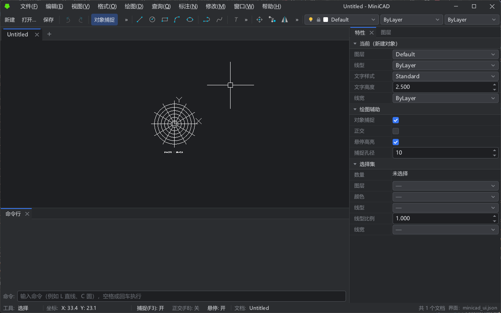

# MiniCAD

2D/3D CAD，桌面版和网页版，一样外观与操作。

- [在线预览网页版](https://minicad.bimhub.top)    
 
- [下载Windows版本](https://github.com/CHMOSE023/MiniCAD/releases)


 

## Windows版编译

需要 CMake 3.20+、Ninja、Visual Studio（MSVC，C++20）。

```bat
cmake --preset debug
cmake --build --preset debug
out\debug\MiniCADWin\MiniCADWin.exe
```
**选择以下任意环境编译** 

-  "Developer Command Prompt for VS"中执行上述命令

-  **PowerShell** VS开发环境： cmd /k """C:\Program Files\Microsoft Visual Studio\18\Community\Common7\Tools\VsDevCmd.bat"" -arch=x64 -host_arch=x64"

-  **PowerShell** x64编译环境： cmd /k """C:\Program Files\Microsoft Visual Studio\18\Community\VC\Auxiliary\Build\vcvars64.bat"""


**发布版用 `release`编译** 

## Web版编译

需要 [Emscripten SDK](https://emscripten.org)（路径 `D:\dev\emsdk`）, Web版编译脚本 `build_wasm.bat` 。

```bat
build_wasm.bat serve
```

输出目录 `out/build/wasm/MiniCADWeb/`，serve 参数，自动启动本地服务器， http://localhost:8080/MiniCADWeb。

## 测试

```bat
run_tests.bat
```
    
## 第三方组件

- SMLib实体建模 [usd-brep](https://github.com/NVIDIA-Omniverse/usd-brep)
- DWG解析移植自 [ACadSharp](https://github.com/DomCR/ACadSharp)
- 图像加载使用 [stb_image](https://github.com/nothings/stb/blob/master/stb_image.h)
- 字体处理使用 [stb_truetype](https://github.com/nothings/stb/blob/master/stb_truetype.h)
- 网页界面字体 [Noto Sans SC](https://github.com/notofonts/noto-cjk)  


## 第三方字体

以下字体文件用于 CAD 图纸的文字显示或字体兼容。
- `GB2312.ttf`
- `simplex.shx`
- `TSSDCHN.SHX`
- `tssdeng.shx`

## 开发入门教程

[LearnMiniCAD](https://github.com/CHMOSE023/LearnMiniCAD) 学习开发CAD。

## 致谢
在积极3D开发功能，版本更新快，期待能尽快稳定下拉，也会尝试加入图像渲染和动画功能，欢迎为仓库贡献。

感谢为MiniCAD做出贡献的人。

[@七只蜗牛](https://github.com/qizhiwoniu)   [@wkslgjx](https://github.com/wkslgjx)  

## 许可证

[MIT](LICENSE) © 2026 CHMOSE023
