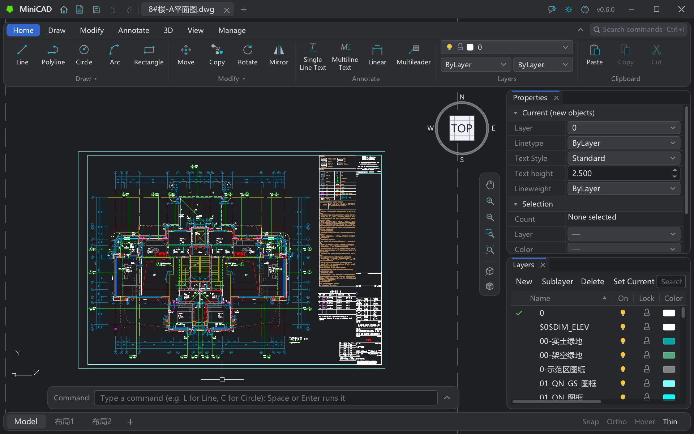

<p align="right">
  English | <a href="README.zh-CN.md">简体中文</a>
</p>

<p align="center">
  
</p>

<h1 align="center">MiniCAD</h1>

<p align="center">
  <strong>An open-source 2D/3D CAD application written in C++20.</strong><br />
  Runs on Windows, Linux, Android and in the browser. Built on the SMLib solid kernel, with node-based 3D modeling, <strong>compatible with DWG and TCH drawings</strong>.
</p>

<p align="center">
  <a href="https://minicad.bimhub.top">Web app</a> ·
  <a href="https://github.com/CHMOSE023/MiniCAD/releases">Desktop downloads</a> ·
  <a href="https://github.com/CHMOSE023/MiniCAD/releases/latest">Android</a>
</p>

<p align="center">
  <a href="https://github.com/CHMOSE023/MiniCAD/actions/workflows/build.yml">
  
  </a>
  <a href="https://github.com/CHMOSE023/MiniCAD/releases/latest"></a>
  <a href="https://github.com/CHMOSE023/MiniCAD/releases"></a>
  <a href="LICENSE"></a>
  <a href="https://qm.qq.com/q/O08yWfRvmE"></a>
  <a href="https://github.com/CHMOSE023/MiniCAD/stargazers"></a>
</p>



> The interface is available in English and Simplified Chinese: choose it under Settings (the gear at the top right) > Language, or start with `--lang en`. By default it follows the system language.

## Building on Windows

Requires CMake 3.20+, Ninja and Visual Studio (MSVC, C++20).

```bat
cmake --preset debug
cmake --build --preset debug
out\debug\MiniCADWin\MiniCADWin.exe
```

**Run the commands above in any of these environments:**

- "Developer Command Prompt for VS"

- **PowerShell** with the VS developer environment: cmd /k """C:\Program Files\Microsoft Visual Studio\18\Community\Common7\Tools\VsDevCmd.bat"" -arch=x64 -host_arch=x64"

- **PowerShell** with the x64 build environment: cmd /k """C:\Program Files\Microsoft Visual Studio\18\Community\VC\Auxiliary\Build\vcvars64.bat"""

**Use the `release` preset for release builds.**

## Building the web version

Requires the [Emscripten SDK](https://emscripten.org) (expected at `D:\dev\emsdk`). The build script is `build_wasm.bat`:

```bat
build_wasm.bat serve
```

Output goes to `out/build/wasm/MiniCADWeb/`. With `serve`, a local server starts automatically at http://localhost:8080/MiniCADWeb.

The web version uses the browser's WebGPU by default and falls back to WebGL2 when WebGPU is not available; add `?webgl` to the URL to force WebGL2. On the first build Emscripten downloads the WebGPU bindings (the emdawnwebgpu port) from GitHub, so an internet connection is required.

## Building on Linux

The releases page has a prebuilt `MiniCAD-<version>-linux-x64.tar.gz` (built on Ubuntu 24.04, SDL3 linked in): extract it and run `./MiniCADLinux`. It needs Mesa's EGL / OpenGL ES and the Vulkan loader (`libegl1`, `libgles2`, `libvulkan1` on Ubuntu). To build it yourself:

Requires CMake 3.20+, Ninja, GCC 13+ or Clang (C++20), the OpenGL ES 3 / EGL development packages and [SDL3](https://github.com/libsdl-org/SDL). On Ubuntu / Debian:

```bash
sudo apt install build-essential cmake ninja-build pkg-config libegl-dev libgles-dev \
    libx11-dev libxext-dev libxrandr-dev libxcursor-dev libxi-dev libxfixes-dev libxss-dev libxtst-dev \
    libxkbcommon-dev libwayland-dev wayland-protocols libdbus-1-dev libudev-dev
```

The Vulkan backend (optional; preferred by default, with automatic fallback to OpenGL ES 3) also needs the headers and the shader compiler:

```bash
sudo apt install libvulkan-dev glslang-tools mesa-vulkan-drivers
```

SDL3: from Ubuntu 25.04 / Debian 13 on, `sudo apt install libsdl3-dev`; on older distributions build and install it from source (for example into `~/sdl3`):

```bash
cmake -S SDL3-3.4.18 -B sdl3-build -G Ninja -DCMAKE_BUILD_TYPE=Release -DCMAKE_INSTALL_PREFIX=$HOME/sdl3 -DSDL_TESTS=OFF
cmake --build sdl3-build && cmake --install sdl3-build
```

Build MiniCAD (drop `CMAKE_PREFIX_PATH` if SDL3 is installed in a system directory):

```bash
cmake -S . -B out/linux -G Ninja -DCMAKE_BUILD_TYPE=Release -DCMAKE_PREFIX_PATH=$HOME/sdl3
cmake --build out/linux
out/linux/MiniCADLinux/MiniCADLinux [drawing ...]
```

Without SDL3 or OpenGL ES 3 only the core libraries and tests are built (`ctest --test-dir out/linux`); without the Vulkan development files or glslangValidator only OpenGL ES 3 is used. At run time, `--gpu vulkan` / `--gpu gl` (or the `MINICAD_GPU` environment variable) selects the graphics backend. The open / save dialogs need xdg-desktop-portal or zenity; without them, drag drawings into the window or pass them on the command line.

## Android

The releases page has a prebuilt `MiniCAD-<version>-android-arm64.apk` for arm64 devices running Android 10 (API 29) or later; download and install it (allow "Install unknown apps"). Phones get a simplified view-only interface: open DWG / DXF drawings (from Files or another app), drag to pan, zoom, and view full screen; annotations will come later. Tablets and devices with a mouse and keyboard get the full interface.

To build it yourself you need JDK 17+ (21 recommended) and these Android SDK packages (install them with Android Studio's SDK Manager or the command-line tools' `sdkmanager`): Platform API 36, Build-Tools 36.1.0, NDK 29.0.14206865, CMake 3.31.6. Set the `ANDROID_HOME` environment variable (or write `sdk.dir=<SDK path>` in `apps/Android/local.properties`), then:

```bat
cd apps\Android
gradlew assembleDebug
```

The APK is written to `out/android/app/outputs/apk/debug/` (debug builds also include x86_64 for the emulator). `gradlew installDebug` builds and installs it on a connected device (enable USB debugging on the phone); view the log with `adb logcat -s MiniCAD`. For a release build run `gradlew assembleRelease` (arm64 only); point the `MINICAD_KEYSTORE`, `MINICAD_KEYSTORE_PASSWORD`, `MINICAD_KEY_ALIAS` and `MINICAD_KEY_PASSWORD` environment variables at your keystore, otherwise the local debug key is used.

## Tests

```bat
run_tests.bat
```

## Third-party components

- Solid modeling: SMLib from [usd-brep](https://github.com/NVIDIA-Omniverse/usd-brep)
- DWG reading and writing ported from [ACadSharp](https://github.com/DomCR/ACadSharp)
- Image loading: [stb_image](https://github.com/nothings/stb/blob/master/stb_image.h)
- Font rendering: [stb_truetype](https://github.com/nothings/stb/blob/master/stb_truetype.h)
- Web UI font: [Noto Sans SC](https://github.com/notofonts/noto-cjk)
- Linux windowing and input: [SDL3](https://github.com/libsdl-org/SDL) (zlib license)
- Test fonts: `GB2312.ttf` `simplex.shx` `TSSDCHN.SHX` `tssdeng.shx`

## Tutorial

[LearnMiniCAD](https://github.com/CHMOSE023/LearnMiniCAD): learn how to build a CAD application (in Chinese).

## Acknowledgements

3D features are under active development and releases come quickly; we hope to reach a stable state soon, and may also add rendering and animation. Contributions are welcome.

Thanks to everyone who has contributed to MiniCAD.

[@七只蜗牛](https://github.com/qizhiwoniu)   [@wkslgjx](https://github.com/wkslgjx)

## License

[MIT](LICENSE) © 2026 CHMOSE023
