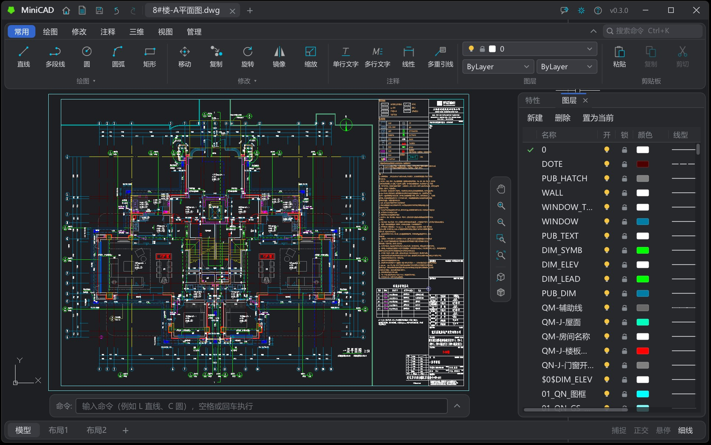

<p align="right">
  <a href="README.md">English</a> | 简体中文
</p>

<p align="center">
  
</p>

<h1 align="center">MiniCAD</h1>

<p align="center">
  <strong>开源 2D/3D CAD 应用，使用C++20开发。</strong><br />
  在 Windows、Linux、安卓和浏览器内运行CAD，内核使用SMLib, 支持三维Node节点建模，<strong>兼容dwg</strong>。
</p>

<p align="center">
  <a href="https://minicad.bimhub.top">网页版</a> ·
  <a href="https://github.com/CHMOSE023/MiniCAD/releases">桌面版</a> ·
  <a href="https://github.com/CHMOSE023/MiniCAD/releases/latest">安卓版</a>     
</p>
 
<p align="center">
  <a href="https://github.com/CHMOSE023/MiniCAD/actions/workflows/build.yml">
  
  </a>
  <a href="https://github.com/CHMOSE023/MiniCAD/releases/latest"></a>
  <a href="https://github.com/CHMOSE023/MiniCAD/releases"></a>
  <a href="LICENSE"></a>
  <a href="https://qm.qq.com/q/O08yWfRvmE"></a>
  <a href="https://github.com/CHMOSE023/MiniCAD/stargazers"></a>
</p>



> 界面有简体中文与英文两种：在右上角"设置 > 语言"里切换，或启动时加 `--lang en`；默认跟随系统语言。

## Windows版编译

需要 CMake 3.20+、Ninja、Visual Studio（MSVC，C++20）。

```bat
cmake --preset debug
cmake --build --preset debug
out\debug\MiniCADWin\MiniCADWin.exe
```
**选择以下任意环境编译** 

-  "Developer Command Prompt for VS"中执行上述命令

-  **PowerShell** VS开发环境： cmd /k """C:\Program Files\Microsoft Visual Studio\18\Community\Common7\Tools\VsDevCmd.bat"" -arch=x64 -host_arch=x64"

-  **PowerShell** x64编译环境： cmd /k """C:\Program Files\Microsoft Visual Studio\18\Community\VC\Auxiliary\Build\vcvars64.bat"""


**发布版用 `release`编译** 

## Web版编译

需要 [Emscripten SDK](https://emscripten.org)（路径 `D:\dev\emsdk`）, Web版编译脚本 `build_wasm.bat` 。

```bat
build_wasm.bat serve
```

输出目录 `out/build/wasm/MiniCADWeb/`，serve 参数，自动启动本地服务器， http://localhost:8080/MiniCADWeb。

网页版默认用浏览器的 WebGPU，不支持时自动改用 WebGL2；网址加 `?webgl` 强制用 WebGL2。第一次构建时 Emscripten 会从 GitHub 下载 WebGPU 绑定（emdawnwebgpu 端口包），需要联网。

## Linux版编译

发布页有编译好的 `MiniCAD-<版本>-linux-x64.tar.gz`（Ubuntu 24.04 上编译）：解压后运行 `./MiniCADLinux`，需要系统装有 Mesa 的 EGL / OpenGL ES 与 Vulkan 加载器（Ubuntu 上是 `libegl1`、`libgles2`、`libvulkan1`），X11、Wayland、xkbcommon、D-Bus 的运行库桌面系统都自带。自己编译：

需要 CMake 3.20+、Ninja、GCC 13+ 或 Clang（C++20）、OpenGL ES 3 / EGL 开发包，以及 X11 与 Wayland 的开发包（至少一套）。以 Ubuntu / Debian 为例：

```bash
sudo apt install build-essential cmake ninja-build pkg-config libegl-dev libgles-dev \
    libx11-dev libxcursor-dev libxext-dev libxkbcommon-dev libwayland-dev wayland-protocols libdbus-1-dev
```

Vulkan 后端（可选，默认优先用它，不行时自动改用 OpenGL ES 3）还要头文件与着色器编译器：

```bash
sudo apt install libvulkan-dev glslang-tools mesa-vulkan-drivers
```

编译 MiniCAD：

```bash
cmake -S . -B out/linux -G Ninja -DCMAKE_BUILD_TYPE=Release
cmake --build out/linux
out/linux/MiniCADLinux/MiniCADLinux [图纸路径 ...]
```

找不到 OpenGL ES 3 / EGL，或 X11、Wayland 的开发包一套都没有时只编译核心库与测试（`ctest --test-dir out/linux`）；只有一套时只支持那一种窗口系统；找不到 Vulkan 开发文件或 glslangValidator 时只用 OpenGL ES 3。运行时有 `WAYLAND_DISPLAY` 就用 Wayland，否则 X11，环境变量 `MINICAD_WINDOWING=x11` / `wayland` 可指定；`--gpu vulkan` / `--gpu gl`（或环境变量 `MINICAD_GPU`）指定图形后端。标题栏由程序自己画（X11，以及不给窗口装饰的 Wayland 合成器，如 GNOME）；X11 下想用窗口管理器的标题栏可设 `MINICAD_X11_DECORATIONS=system`。打开、保存文件的对话框走 xdg-desktop-portal，没有时用 zenity，都没有时可以把图纸拖进窗口或在命令行上给出。

## 安卓版

发布页有编译好的 `MiniCAD-<版本>-android-arm64.apk`：Android 10（API 29）及以上的 arm64 设备，下载后安装（要允许"安装未知应用"）。手机上是只浏览的简化界面：打开 DWG / DXF（从"文件"或其他应用打开）、拖动平移、缩放、全屏查看，之后会加批注；平板与接了鼠标键盘的设备用完整界面。

自己编译需要 JDK 17+（推荐 21）与 Android SDK 的以下组件（用 Android Studio 的 SDK Manager 或 command-line tools 的 `sdkmanager` 安装）：Platform API 36、Build-Tools 36.1.0、NDK 29.0.14206865、CMake 3.31.6。设好环境变量 `ANDROID_HOME`（或在 `apps/Android/local.properties` 里写 `sdk.dir=<SDK 路径>`），然后：

```bat
cd apps\Android
gradlew assembleDebug
```

APK 在 `out/android/app/outputs/apk/debug/`（调试版另带 x86_64，可在模拟器上运行）。`gradlew installDebug` 编完直接装到连着的设备（手机要打开 USB 调试），看日志用 `adb logcat -s MiniCAD`。发布版用 `gradlew assembleRelease`（只编 arm64）；签名用环境变量 `MINICAD_KEYSTORE`、`MINICAD_KEYSTORE_PASSWORD`、`MINICAD_KEY_ALIAS`、`MINICAD_KEY_PASSWORD` 指定密钥库，没设时用本机的调试密钥。

## 测试

```bat
run_tests.bat
```
    
## 第三方组件

- SMLib实体建模 [usd-brep](https://github.com/NVIDIA-Omniverse/usd-brep)
- DWG解析移植自 [ACadSharp](https://github.com/DomCR/ACadSharp)
- 图像加载使用 [stb_image](https://github.com/nothings/stb/blob/master/stb_image.h)
- 字体处理使用 [stb_truetype](https://github.com/nothings/stb/blob/master/stb_truetype.h)
- 网页界面字体 [Noto Sans SC](https://github.com/notofonts/noto-cjk)  
- 单线字体 `minicad_*.shx` 的笔画：[Make Me a Hanzi](https://github.com/skishore/makemeahanzi)（Arphic PL）、[KanjiVG](https://kanjivg.tagaini.net)（CC BY-SA 3.0）  
- 测试字体  `GB2312.ttf` `simplex.shx`  `TSSDCHN.SHX` `tssdeng.shx`

## 入门教程

[LearnMiniCAD](https://github.com/CHMOSE023/LearnMiniCAD) 学习开发CAD。

## 致谢
在积极3D开发功能，版本更新快，期待能尽快稳定下拉，也会尝试加入图像渲染和动画功能，欢迎为仓库贡献。

感谢为MiniCAD做出贡献的人。

[@七只蜗牛](https://github.com/qizhiwoniu)   [@wkslgjx](https://github.com/wkslgjx)  

  
## 许可证

[MIT](LICENSE) © 2026 CHMOSE023
